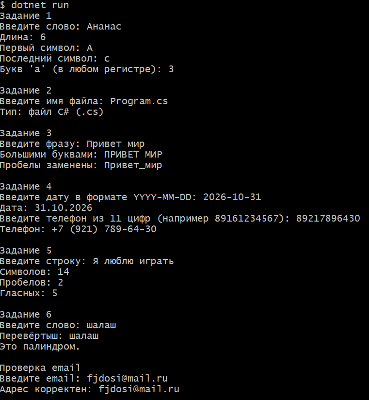
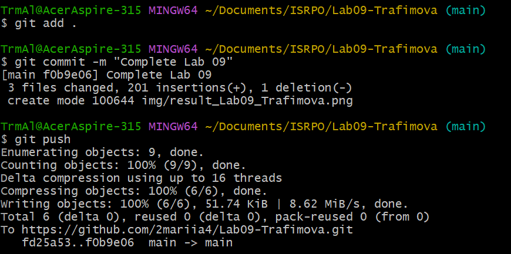

# Практическая работа №9

**ФИО:** Трафимова Мария Алексеевна
**Группа:** ИСП-242

## Что изучено

- Строка в C# — неизменяемая последовательность символов. Методы `ToUpper`, `ToLower`, `Replace`, `Substring` возвращают **новую** строку, а исходную не меняют, поэтому результат обязательно нужно сохранять в переменную или выводить сразу.
- Строку можно перебирать через `foreach` и обращаться к символам по индексу `s[i]`, как к массиву; `s.Length` — количество символов.
- Для проверки содержимого удобны `Contains`, `StartsWith`, `EndsWith`; для безопасного сравнения регистра — приведение через `ToLower()/ToUpper()`.
- Для сборки строки в цикле лучше использовать `StringBuilder`, чтобы не создавать новую строку на каждом шаге через `+=`.

